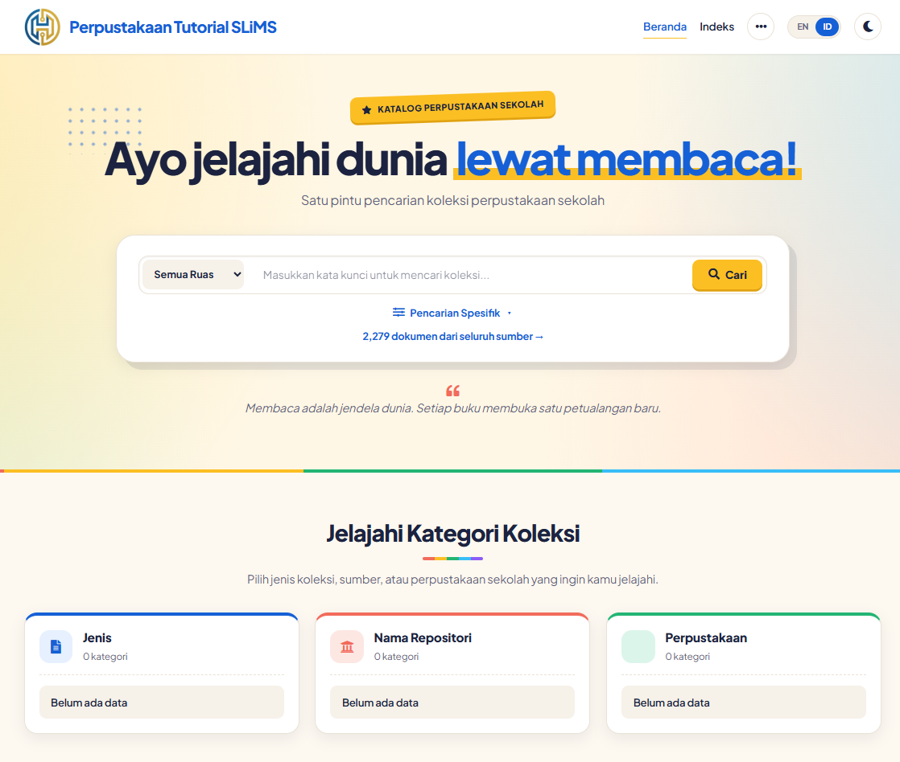

# Pustaka Ceria

Template OPAC untuk **SLiMS 9.8.0** dengan tampilan ceria dan ramah anak/sekolah.
Mendukung dua bahasa (Indonesia / English) lewat tombol **ID | EN** di navbar.

Dibuat oleh **Tutorial SLiMS**.

Template ini merupakan ide dari Hendro Wicaksono | Email : hendro.wicaksono@gmail.com

## Fitur

- Beranda dengan pencarian terpadu, kategori koleksi, dan subjek populer
- Halaman hasil pencarian (tampilan daftar / kisi) dan halaman detail dengan "Dokumen Serupa"
- Dua bahasa: Indonesia dan English
- Mode terang / gelap
- Responsif (HP, tablet, desktop)

## Kebutuhan

- SLiMS 9.8.0
- Koneksi internet (font Plus Jakarta Sans dimuat dari Google Fonts)

## Cara pasang

1. Unduh repositori ini (tombol **Code → Download ZIP**) lalu ekstrak.
2. Salin folder `pustaka_ceria` ke folder `template/` di instalasi SLiMS Anda
   sehingga hasilnya `slims/template/pustaka_ceria/`.
3. Login ke Admin SLiMS, buka **Sistem → Template**.
4. Pada kartu **Pustaka Ceria**, klik **Aktifkan**.
5. Muat ulang halaman OPAC (Ctrl + F5).

> Logo diambil dari pengaturan SLiMS (Sistem → Pengaturan Sistem → Logo).

## Catatan

- Jika tombol **MARC** di halaman detail menampilkan error
  `require_once(PEAR/Exception.php)`, server PHP Anda belum memiliki paket PEAR.
  Pasang paket PEAR, atau lihat dokumentasi SLiMS untuk ekspor MARC.
- Terjemahan tambahan ada di `lang.php`. Silakan ubah bila ingin menyesuaikan kalimat.

## Kredit

Template ini dibangun di atas struktur template bawaan SLiMS
(Waris Agung Widodo, Arie Nugraha, dan kontributor SLiMS lainnya) dan memakai
pustaka open source berikut di folder `assets/`:

| Pustaka | Lisensi |
| --- | --- |
| [Bootstrap](https://getbootstrap.com) | MIT |
| [jQuery](https://jquery.com) | MIT |
| [Vue.js](https://vuejs.org) | MIT |
| [Popper.js](https://popper.js.org) | MIT |
| [Axios](https://axios-http.com) | MIT |
| [Masonry](https://masonry.desandro.com) | MIT |
| [Vegas](https://vegas.jaysalvat.com) | MIT |
| [Tailwind CSS](https://tailwindcss.com) | MIT |
| [Font Awesome Free](https://fontawesome.com) | Ikon CC BY 4.0, font SIL OFL 1.1, kode MIT |
| [flag-icons](https://github.com/lipis/flag-icons) | MIT |

Seluruh hak cipta pustaka di atas tetap milik pemiliknya masing-masing.

## Bantuan

Apapun masalah error SLiMS, kami siap membantu, silakan DM ke Instagram.

- Email: tutorialslims@gmail.com
- Instagram: [@tutorial_slims](https://instagram.com/tutorial_slims)

## Atribusi (wajib dipertahankan)

Template ini membawa blok atribusi dan kontak di bagian bawah halaman (footer):

> Apapun masalah error SLiMS, kami siap membantu, silakan DM ke Instagram.
> tutorialslims@gmail.com · @tutorial_slims

Syarat tambahan sesuai GPLv3 pasal 7(b) (pelestarian atribusi penulis dan pemberitahuan hukum):

1. Blok atribusi/kontak di footer, tulisan "Template by Tutorial SLiMS", serta komentar
   hak cipta di bagian atas setiap berkas **tidak boleh dihapus, disembunyikan, atau diubah**.
2. Jika Anda membagikan ulang template ini (asli maupun hasil modifikasi), atribusi tersebut
   harus tetap ada dan terlihat.
3. Anda tetap bebas mengubah desain, warna, tata letak, dan fitur lainnya.

Kode di `parts/_credit.php`, `assets/js/kd-credit.js`, dan `index_template.inc.php` berfungsi
menjaga blok ini tetap tampil. Menghapus atau menonaktifkannya berarti melanggar ketentuan di atas.

## Lisensi

© Tutorial SLiMS.

Template ini dirilis di bawah **GNU General Public License v3.0 (GPLv3)**, sama seperti SLiMS,
dengan syarat tambahan pelestarian atribusi pada bagian **Atribusi** di atas.
Anda bebas menggunakan, mengubah, dan membagikan ulang sesuai ketentuan GPLv3.
Lihat berkas [LICENSE](LICENSE) untuk teks lengkapnya.
